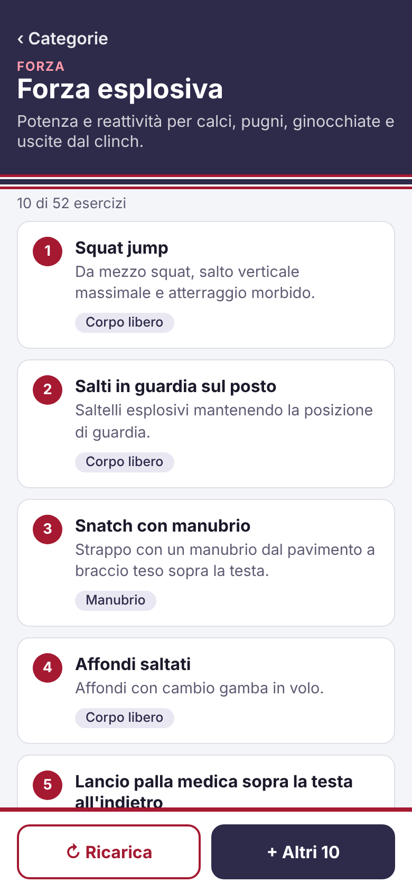
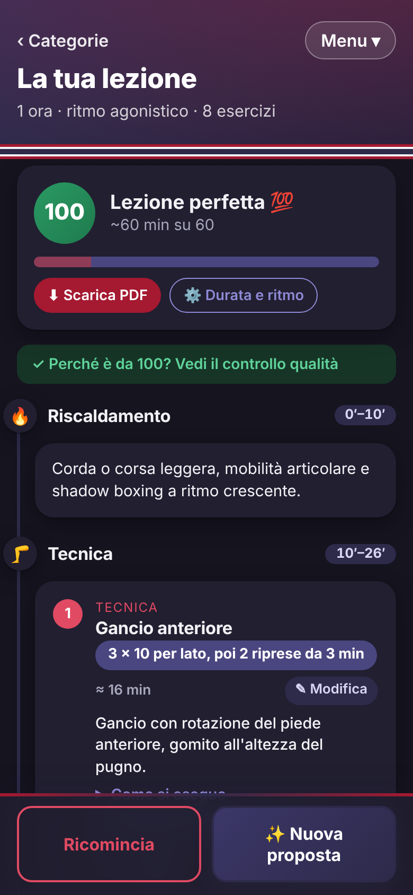

# TeamPetrux
App Muay Thai per strutturare gli allenamenti: scegli una categoria e ottieni esercizi specifici di Muay Thai a caso.



## Cosa fa

- **Menu a tendina** in alto per passare tra *Categorie esercizi*, *Crea allenamento* e *Impostazioni lezione*.
- **Impostazioni**: lezione da 1 ora o 1 ora e 30, ripresa da 2 min (leggero) o 3 min (agonistico).
  I primi 10 minuti sono sempre di riscaldamento. Cambiando durata, le liste si ricaricano da sole per stare nel tempo.
- **Categorie**: tocchi una categoria e vedi fino a 10 esercizi a caso che stanno nel tempo della lezione.
  **↻ Ricarica** ne estrae altri diversi, **+ Altri 10** ne aggiunge 10 non ancora visti.
- Ogni esercizio ha il **dosaggio** (ripetizioni, serie, tempo o riprese), il tempo stimato e una **descrizione estesa**.
  I lavori a riprese da 2–3 min seguono la durata della ripresa scelta.
- **Esercizi per attrezzo**: corpo libero, compagno, palla medica, corda, kettlebell, elastici, sacco, pao, bilanciere, manubri,
  sbarra e parallele, battle rope, sandbag, pneumatico e mazza, coni e scaletta, ognuno con almeno 24 esercizi.
  Funzionano come le categorie (10 a caso nel tempo della lezione, Ricarica, Altri 10, torna indietro).
  Negli esercizi delle categorie, l'attrezzo è un collegamento alla lista di quell'attrezzo.
- **Dosaggio modificabile**: con "✎ Modifica" scrivi le tue ripetizioni, serie o tempi per ogni esercizio;
  restano salvati, valgono ovunque e contano nella stima del tempo. "Ripristina originale" torna a quello del catalogo.
- **Crea allenamento**: aggiungi gli esercizi dalle categorie con "+ Aggiungi all'allenamento", riordinali e toglili;
  oppure **⚡ Crea lezione automatica** compone la lezione in ordine logico: riscaldamento, tecnica, velocità o footwork,
  clinch, condizionamento, forza, core e mobilità per defaticare.
- Tutto resta salvato nel browser (localStorage): nessun database, nessun costo. Ogni dispositivo ha i suoi dati.
- Colori della bandiera thailandese, pensata prima per il telefono (anche tema scuro).



## Avvio in locale

Serve Node.js 20 o più recente (https://nodejs.org).

```bash
npm install
npm run dev
```

Apri l'indirizzo che compare (di solito http://localhost:5173).
Per provarla dal telefono sulla stessa rete Wi‑Fi: `npm run dev -- --host` e apri l'indirizzo "Network".

## Versione finale

```bash
npm run build     # crea la cartella dist/
npm run preview   # la prova in locale
```

`dist/` è un sito statico: si può pubblicare gratis (es. Netlify, Vercel, GitHub Pages).

## Struttura

- `src/App.tsx` – stato dell'app e scelta della pagina (indirizzi `#/`, `#/categoria/...`, `#/allenamento`, `#/impostazioni`)
- `src/pages/` – le pagine (anche `#/attrezzi` e `#/attrezzo/...`); `src/components/` – menu, impostazioni, riepilogo tempi, scheda esercizio
- `src/lib/plan.ts` – esercizi che stanno nel tempo e lezione automatica
- `src/data/exercises.ts` – catalogo esercizi (generato dal catalogo del progetto, non modificarlo a mano)
- `src/lib/random.ts` – estrazione casuale senza ripetizioni
- `src/lib/lesson.ts` – impostazioni lezione, adattamento delle riprese e stima dei tempi
- `src/lib/doses.ts` – dosaggi personalizzati
- `src/lib/storage.ts` – salvataggio in localStorage
- `src/index.css` – stile e colori (rosso `#A51931`, bianco, blu `#2D2A4A`)
